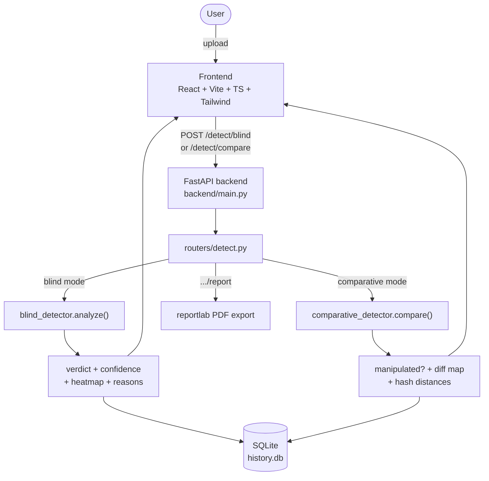
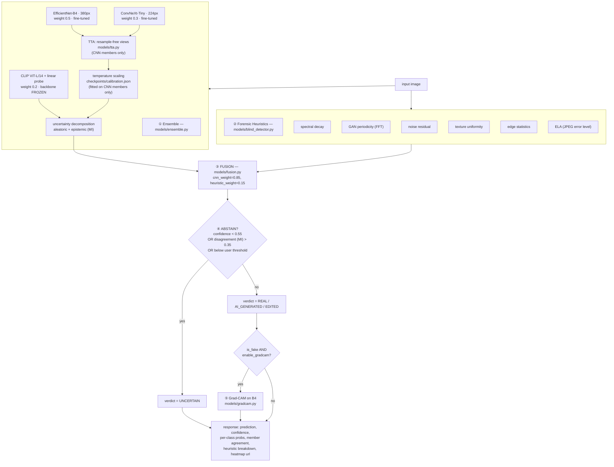
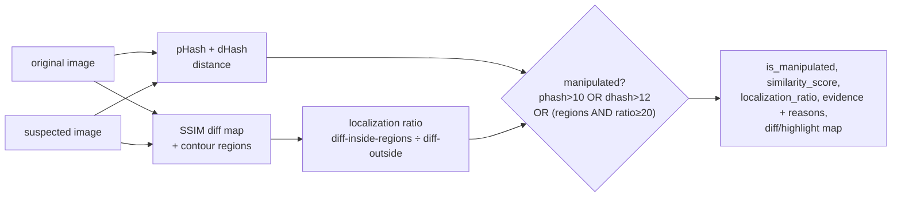
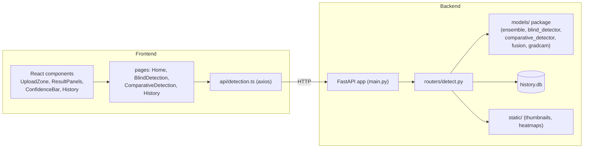
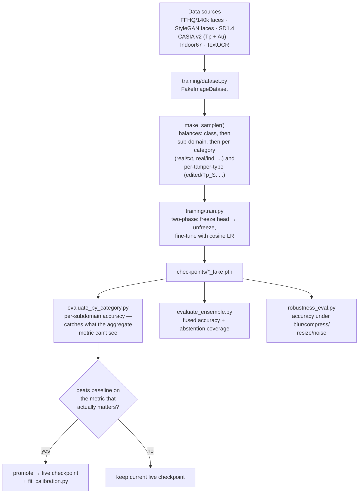

# FakeGuard AI — System Architecture

How the system actually works, end to end. For what's known-broken or
traded-off, see [PROJECT_SPEC.md](PROJECT_SPEC.md)'s Honest Status section —
this file explains the mechanism, that one tracks its current limitations.

## 1. What it does

Takes an image and answers one of two questions:

- **Blind detection** — "is this image REAL, AI_GENERATED, or EDITED?"
  No reference needed, single upload.
- **Comparative detection** — "what changed between these two images?"
  Original + suspected pair, localizes the difference.

Every blind verdict can also come back **UNCERTAIN** — the system is built
to refuse a guess rather than hand back a confident wrong answer.

## 2. Top-level flow



## 3. Blind detection pipeline

This is the core of the system — two independent signal sources are fused,
then gated by an abstention check before anything is returned as a verdict.



### ① Ensemble — the primary signal

Three members, two fine-tuned CNNs plus one frozen foundation-model probe,
deliberately different from each other so they fail on different inputs
instead of sharing blind spots:

| Model | Resolution | Weight | Training | Why |
|---|---|---|---|---|
| EfficientNet-B4 | 380px | 0.5 | fine-tuned end-to-end | finer input detail → more forensic signal retained |
| ConvNeXt-Tiny | 224px | 0.3 | fine-tuned end-to-end | secondary vote, decorrelated errors from B4 |
| CLIP ViT-L/14 + linear probe | 224px | 0.2 | **backbone frozen**, only a linear head trains | generalization to generators absent from this project's training data — see below |

The two CNNs are fine-tuned on this project's training set, which teaches them
*that set's* generators' artifacts (StyleGAN, Stable Diffusion 1.4/2.1).
Measured directly in this project (`training/generate_diffusion_data.py`):
before a generator was added to training, both CNN members failed on it
**identically** — 25/30 confidently wrong, near-zero disagreement — because
fine-tuning teaches generator-specific fingerprints, not a general "is this
synthetic" concept. The CLIP member exists to break that pattern: its backbone
is never fine-tuned, so it encodes a broad prior over natural-image statistics
learned from hundreds of millions of images, rather than this project's
specific generator set. It runs at a materially lower val macro-F1 in-
distribution (0.85 vs. the CNNs' 0.86-0.90) — expected, a linear probe is a
weaker fit to *this* training set by design — but it fails differently enough
from the CNNs to add real signal: on a controlled A/B (`clip_member_ab_test.
metrics.json`), adding it converted one previously-abstained held-out
detection to correct and roughly doubled mean member disagreement, meaning it
is measurably contributing a different perspective, not just riding along.

The two CNN members run **test-time augmentation** (resample-free views only
— a lesson learned the hard way: augmented views that resample the image push
it out of the classifier's input distribution and *reduce* accuracy, see git
history `5da4bae`). Their logits are weight-averaged, then passed through a
fitted **temperature scaling** factor (`calibration.json`) so the reported
confidence reflects real accuracy, not raw softmax overconfidence. The CLIP
member currently runs under that same shared temperature as an approximation
— `fit_calibration.py` doesn't yet fit it separately, a known gap flagged in
that file's code, not silent.

**Uncertainty isn't one number.** The ensemble decomposes predictive entropy
into:

- **Aleatoric** — the image is genuinely ambiguous; more models wouldn't help.
- **Epistemic** (mutual information between members) — the members
  *disagree*, the signature of an input unlike anything in training. This is
  the dangerous kind — a single model asked to extrapolate is often
  confidently wrong.

High epistemic uncertainty is what drives abstention, not just low confidence
— an input can have a "confident" softmax score from each individual member
while the members confidently disagree with each other.

### ② Forensic heuristics — the explainable cross-check

Six signal-based scores computed independently of any trained model
(`models/blind_detector.py`):

| Signal | What it catches |
|---|---|
| Spectral decay | unnatural frequency falloff from generative upsampling |
| GAN periodicity (FFT) | periodic peaks at N/2 multiples — a GAN upsampling fingerprint |
| Noise residual | inconsistent sensor-noise pattern across the image |
| Texture uniformity | over-smooth regions typical of generated content |
| Edge statistics | gradient anomalies at manipulation boundaries |
| ELA (error level analysis) | JPEG re-compression inconsistency at edited regions |

These don't have a training set to overfit to, so they act as an
independent cross-check on the CNN rather than a competing vote — see ③.

### ③ Fusion

`models/fusion.py` blends the two probability distributions:

```
fused[class] = 0.85 × cnn_prob[class] + 0.15 × heuristic_prob[class]
```

The CNN dominates (it's the far stronger signal — val macro-F1 in the 0.85-
0.90 range vs. heuristics alone); heuristics mainly matter when they
*disagree* with the CNN, which is surfaced to the user as a scrutiny flag
even though the fused verdict still follows the CNN.

### ④ Abstention gate

A verdict is downgraded to **UNCERTAIN** if any of:

- fused confidence < 0.55 (`MIN_CONFIDENCE`)
- member disagreement (mutual information) > 0.35 nats (`MAX_DISAGREEMENT`,
  out of ln(3) ≈ 1.0986 max possible for 3 classes)
- fused confidence < the caller-supplied `confidence_threshold` (default 0.5)

This is a deliberate design stance: an honest non-answer is preferred over a
confident wrong one.

### ⑤ Grad-CAM

Computed from the **EfficientNet-B4 member specifically**, not the fused
output — a fused score has no single feature map to attribute against, and
B4's 380px input gives a finer activation grid than ConvNeXt's 224px one.
Generated even when the verdict is UNCERTAIN, since that's exactly when a
human reviewer needs to look closest.

## 4. Comparative detection pipeline



No trained model here — pure signal comparison
(`models/comparative_detector.py`). Perceptual hash distance catches
structural content changes; the diff map's **localization ratio** —  mean
pixel difference inside the flagged regions vs. outside them — separates
genuine local edits from harmless re-compression, which SSIM magnitude alone
cannot do.

This replaced an OR of three loose thresholds (`score < 0.95 OR any region OR
phash > 10`) that measured 81.6% false-alarm rate on 250 authentic CASIA
images against their own re-compressed copies — a plain JPEG re-save tripped
it almost every time, because SSIM does not separate "re-compressed" from
"edited" (a genuine splice measured SSIM 0.955 while a clean q=30 re-save of
the *same* image measured 0.933 — worse). What does separate them is *where*
the difference sits: re-compression spreads error diffusely across the whole
image, editing concentrates it. Localization ratio measures exactly that;
validated on 3396 real CASIA forgery/authentic pairs (recovered from CASIA's
own filenames): forgery recall 95.6%, false-alarm rate 0.0%, F1 0.978 (up
from 0.703).

## 5. Serving stack



- **Frontend**: React + Vite + TypeScript + Tailwind, dark theme.
- **Backend**: FastAPI, CORS-scoped to the local dev frontend ports.
- **History**: every detection (blind or comparative) is persisted to SQLite
  with its thumbnail, retrievable via `/detect/history`.
- **Reports**: `.../report` endpoints render the same analysis into a PDF
  via `reportlab`.

## 6. Training pipeline (offline, not part of the request path)



The sampler is the load-bearing piece here — it's been extended three times
this project's life as thinner and thinner sub-populations turned out to be
invisible to coarser balancing (class-only → sub-domain → per-category /
per-tamper-type). See PROJECT_SPEC.md's Honest Status for the specific bugs
each extension fixed.

## 7. Directory map

```
backend/
  main.py                 FastAPI app entrypoint
  routers/detect.py       /detect/blind, /detect/compare, /history, .../report
  db.py                   SQLite history persistence
  models/
    ensemble.py           3-model weighted ensemble, calibration, abstention
    clip_detector.py      frozen CLIP vision tower + linear probe (3rd member)
    blind_detector.py     orchestrates heuristics + ensemble → verdict
    comparative_detector.py   pHash/dHash + SSIM localization-ratio comparison
    fusion.py              CNN + heuristic probability blending
    gradcam.py             Grad-CAM heatmap generation
    tta.py                  test-time augmentation views (CNN members only)
    cnn_model.py            model architectures (EfficientNet-B4, ConvNeXt-Tiny)
    calibration.py          temperature scaling load/apply
  training/
    dataset.py              FakeImageDataset + balanced sampler
    train.py                two-phase fine-tuning loop (CNN members)
    train_clip_probe.py     extract frozen CLIP features, fit linear probe
    evaluate.py, evaluate_ensemble.py, evaluate_by_category.py,
    robustness_eval.py       metrics tooling
    fit_calibration.py       temperature fitting (CNN members only — see §3①)
    download_data.py         Kaggle dataset acquisition + organization
  checkpoints/               *.pth (gitignored) + calibration.json,
                              *_by_category.json, *.metrics.json (tracked)
  reports/pdf_report.py       PDF export
frontend/
  src/pages/                 Home, BlindDetection, ComparativeDetection, History
  src/components/             UploadZone, ResultPanels, ConfidenceBar, Navbar
  src/api/detection.ts         axios client
```

## 8. Tech stack

| Layer | Tech |
|---|---|
| Model training | PyTorch, AMP, torchvision |
| Model architectures | EfficientNet-B4, ConvNeXt-Tiny (fine-tuned) + CLIP ViT-L/14 (frozen, linear probe only) |
| Backend | FastAPI, Uvicorn, SQLite |
| Image / signal processing | Pillow, OpenCV, scikit-image, SciPy, ImageHash |
| Foundation model | transformers (CLIPVisionModelWithProjection) |
| Reports | ReportLab (PDF) |
| Frontend | React, Vite, TypeScript, Tailwind CSS, axios |
| Dataset acquisition | Kaggle API |
