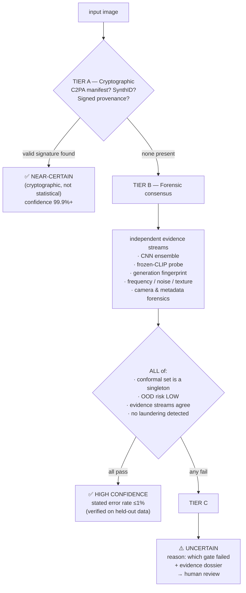

# Plan: Getting to "100% Sure" on AI-Generated vs. Real

Goal as stated: *a confident, certain answer to "is this AI-generated or real?"*

This document is the honest engineering path to that goal. It starts by being
precise about which version of the goal is reachable, because the difference
determines the entire architecture.

Companion to [RESEARCH_PROPOSAL_GENERATION_FINGERPRINT.md](RESEARCH_PROPOSAL_GENERATION_FINGERPRINT.md)
(the research contribution) and [RESEARCH_ROADMAP.md](RESEARCH_ROADMAP.md)
(the broader agenda). This one is narrower and more practical: **how to make
the answers this system gives be trustworthy**, rather than how to make it
answer more often.

---

## 1. The constraint, stated plainly

**100% accuracy on every image is impossible.** Not "hard", not "needs more
data" — structurally unreachable. Four independent reasons, any one of which
alone is sufficient:

1. **Generators are explicitly trained to be indistinguishable.** That is the
   literal training objective of a GAN discriminator and the implicit
   objective of diffusion likelihood training. As generators improve, the
   statistical gap between real and synthetic shrinks toward zero *by
   design*. A detector chasing that gap is chasing a target whose whole
   purpose is to close it.

2. **Laundering destroys the evidence.** Every low-level trace this system
   relies on — spectral decay, upsampling periodicity, noise residual,
   texture statistics, JPEG artifacts — lives in high-frequency content. A
   screenshot, a resize, a social-media re-encode, a print-and-rescan
   removes it. Two heavily laundered images, one real and one synthetic, can
   carry near-identical measurable evidence. When the evidence is gone, no
   model recovers it; there is nothing left to read.

3. **Adversarial perturbation flips any detector.** Published results show
   SOTA detectors dropping to **0% accuracy** under imperceptible
   perturbations that survive JPEG compression. Anyone motivated to defeat a
   passive detector can. This is unsolved in the literature, not just here.

4. **The categories genuinely overlap.** Modern phone photos run learned
   denoisers, learned demosaicing, computational HDR, and neural portrait
   blur *in the camera pipeline*. A "real" photo already contains generated
   pixels. Meanwhile an AI-edited photo is 95% camera sensor data. There is
   no crisp line in the world for a classifier to find — the ambiguity is in
   the subject matter, not the model.

**Information-theoretically:** where two distributions overlap, Bayes error
is greater than zero. No classifier, of any size, trained on any amount of
data, achieves zero error on overlapping distributions. This is a theorem,
not a limitation of the current approach.

**Measured in this project, twice:** a detector at a claimed 0.997 EDITED F1
turned out to be reading a subject-matter shortcut ("not a face → EDITED"),
and both CNN ensemble members shared an identical blind spot on an unseen
generator — 25/30 confidently wrong, with near-zero disagreement, so
abstention never fired. This session added a third data point: a model
trained on five diffusion families scored **40.0%** on a sixth held out
(DALL·E 3), and the baseline CNN scored **42.5%** on held-out SD1.4. Both
near or below chance on unseen generators. Any claim of 100% would have to
survive those numbers; none does.

**Anyone claiming 100% blind AI-image detection is either measuring on a
test set that leaked, or lying.** Commercial vendors quoting 98-99% are
quoting in-distribution numbers on generators they trained on.

---

## 2. The version of the goal that *is* reachable

Reframe from:

> ❌ "Be right about every image."

to:

> ✅ **"Never be confidently wrong. When the system gives an answer, that
> answer is right ≥99% of the time — and when it can't reach that bar, it
> says so instead of guessing."**

This is **selective prediction** (also called prediction with a reject
option). It trades *coverage* for *precision*. The system answers fewer
questions, and every answer it does give carries a stated, verified error
rate.

That is a genuinely achievable "100% sure" — not 100% of images, but
near-certainty on the ones it commits to, plus honest refusal on the rest.
For forensic use this is strictly more valuable than higher raw accuracy: a
flagged unknown gets human review, a confident false answer does not.

**The metric change that follows from this is the single most important
decision in this plan:**

| Stop optimizing | Start optimizing |
|---|---|
| accuracy at 100% coverage | **coverage at ≥99% precision** |
| "how often are we right?" | "how much can we answer while staying ≥99% right?" |

Every experiment below reports the second, not the first.

---

## 3. Architecture: three certainty tiers

Route every image into exactly one tier. The tiers differ in *kind of
evidence*, not just confidence threshold — that is what makes Tier A's
certainty real rather than a calibration artifact.

### Tier A — Cryptographic certainty (the only true ~100%)

Not statistics. Math. A valid C2PA signature or a detected SynthID watermark
identifies an image's origin with cryptographic confidence, no model
inference involved.

- **C2PA Content Credentials** — signed provenance manifest. As of 2026:
  OpenAI ships them on ChatGPT/API images, Google, Nvidia, Adobe, and
  ElevenLabs are adopters, Pixel 8/9/10 embed them at capture, and
  verification is landing in Google Search and Chrome.
- **SynthID** — Google has watermarked 100B+ files; OpenAI ships SynthID
  alongside C2PA as of May 2026.
- **Container forensics** — EXIF consistency, JPEG quantization-table
  fingerprinting, thumbnail-vs-image mismatch, double-compression traces,
  software tags. Classical, cheap, forensically standard, currently absent
  from this system entirely.

**The asymmetry that must be explicit in code:** *presence* of a valid
manifest is strong evidence. *Absence* proves nothing — most tools emit
none, and manifests are trivially stripped by a screenshot. Treating absence
as evidence of realness would be a serious, exploitable bug.

**Realistic coverage:** maybe 10-30% of AI images from major providers
today, growing. Zero effort spent on model training; this is parsing and
signature verification. **Highest certainty per unit of work in the entire
plan, by a wide margin.**

### Tier B — Forensic consensus with a guarantee

For images with no provenance. Answer *only* when every independent gate
passes:

1. **Conformal prediction set is a singleton.** Not a confidence threshold —
   a distribution-free coverage guarantee (Angelopoulos & Bates). Choose
   α = 0.01 and the true class is in the set ≥99% of the time. Singleton →
   commit. Multi-class → genuine ambiguity → Tier C. Empty → outside the
   calibration distribution entirely → Tier C. Already scripted in
   [calibrate_fingerprint.py](backend/training/calibrate_fingerprint.py).
2. **OOD risk is LOW.** Mahalanobis + energy score on the fingerprint
   embedding. Catches "this is unlike anything in training" — the unseen-
   generator case where the current system is most dangerous. Already
   implemented in [models/fingerprint/ood.py](backend/models/fingerprint/ood.py).
3. **Independent evidence streams agree.** CNN ensemble, frozen-CLIP probe,
   generation fingerprint, and handcrafted heuristics use *different*
   evidence. Agreement across genuinely decorrelated signals is meaningful;
   agreement between two fine-tuned CNNs is not (measured here: they share
   blind spots).
4. **No laundering detected.** If the image shows heavy re-compression,
   screenshot signatures, or resampling, the low-level evidence Tier B
   depends on is degraded — route to Tier C rather than reading noise. This
   gate is what stops the system being confidently wrong on laundered
   inputs.

### Tier C — Honest refusal

Everything else. Returns `UNCERTAIN` **with the specific reason** (which
gate failed), the full evidence dossier, and the generation trace map for a
human reviewer. Not a failure state — the product.

---

## 4. Build order

Ordered by certainty gained per unit of effort. Items 1-3 are the ones that
actually move the goal.

| # | Item | Effort | Certainty gained | Status |
|---|---|---|---|---|
| 1 | **C2PA + SynthID + container/EXIF forensics (Tier A)** | S | ★★★★★ | not started — **highest value, do first** |
| 2 | **Selective-prediction evaluation harness** (accuracy-vs-coverage curve; report coverage @99% precision) | S | ★★★★★ | not started — *needed to measure everything else* |
| 3 | **Conformal decision layer wired into the live verdict** | S | ★★★★ | script written, not wired in |
| 4 | **OOD gate wired into the live verdict** | S | ★★★★ | implemented, not wired in |
| 5 | **Laundering detector** (screenshot / re-compression / resample signature → force Tier C) | M | ★★★★ | not started |
| 6 | **Multi-stream agreement gate** (requires fingerprint module trained) | M | ★★★ | fingerprint training in progress |
| 7 | **Adversarial + laundering robustness measurement** | M | ★★★ | benign-only today (`robustness_eval.py`) |
| 8 | Generation fingerprint LOGO validation (research claim) | L | ★★★ | in progress — first result 40.0%, GRL retune running |

**Note on ordering:** items 1 and 2 together get most of the way to the goal
and involve *no model training at all*. Item 1 provides genuine
near-certainty for a growing share of inputs; item 2 makes the certainty of
everything else measurable. Both are days of work, not weeks. The research
work (item 8) is valuable but is not the fastest path to "confident
results."

---

## 5. Metrics that replace "accuracy"

Report these instead of a single accuracy number:

- **Coverage @ 99% precision** — what fraction of images can be answered
  while staying ≥99% right. *The headline number.*
- **Coverage @ 99.9% precision** — the forensic-grade bar.
- **Accuracy-vs-coverage curve** — the full tradeoff, not one point on it.
- **Selective risk** — error rate on the answered subset.
- **Tier A hit rate** — fraction resolved cryptographically.
- **ECE / reliability diagram** — is a stated 95% confidence actually 95%?
- **False-REAL rate specifically** — the dangerous direction. Calling a fake
  image real is worse than the reverse for every use case this system has.
- **Coverage under laundering** — how much the answerable fraction shrinks
  after JPEG/screenshot/resize. Expected and correct that it shrinks.
- **Unseen-generator coverage** — same, for generators absent from training.

---

## 6. Realistic expected outcome

Honest projection, given this project's measured numbers and the published
state of the art. These are *targets to verify*, not claims:

| Input type | Expected outcome |
|---|---|
| AI image with C2PA/SynthID intact | ~99.9% certain, Tier A |
| Clean AI image, generator in training set | high confidence, Tier B, most answered |
| Clean AI image, **unseen** generator | **mostly Tier C (UNCERTAIN)** — correct behavior; the alternative is confidently wrong |
| Clean real photo with intact EXIF/camera evidence | high confidence, Tier B |
| Screenshot / heavily laundered anything | **mostly Tier C** — evidence is genuinely gone |
| Adversarially perturbed image | **not reliably detectable** — unsolved, must be stated as a known limit |
| AI-edited real photo | localization via trace map; verdict often Tier C without the AI_EDITED training data (still blocked on DEFACTO's gated access) |

Plausible aggregate: **60-80% coverage at ≥99% precision on clean inputs,
falling sharply on laundered ones.** That is a strong, defensible result. It
is not 100% of images, and no honest system will be.

---

## 7. What stays impossible — state this in the product

Do not let the UI imply otherwise:

- Blind detection of a sufficiently good future generator, with no
  provenance and no laundering artifacts.
- Any guarantee against a motivated adversary with white-box access.
- A crisp real/AI verdict on the computational-photography continuum
  (in-camera neural processing is already "AI" by some definitions).
- Recovering evidence that laundering destroyed. Gone is gone.

**Product implication:** the frontend should show the tier and the reason,
not just a percentage. "UNCERTAIN — image shows screenshot re-compression,
forensic evidence degraded" is a genuinely useful answer. "AI Generated —
73%" on the same image is worse than useless, because it invites a decision
the evidence cannot support.

---

## 8. Immediate next actions

1. **Build the selective-prediction harness** (`evaluate_selective.py`) —
   accuracy-vs-coverage over the existing ensemble. One script, no training.
   Establishes the real baseline for every claim that follows.
2. **Build the provenance layer** (`models/provenance.py`) — C2PA manifest
   parse + signature check, EXIF/quantization-table forensics, SynthID probe
   where an API is available. Wire as a pre-inference stage in
   `routers/detect.py`, evidence-only, with the presence/absence asymmetry
   explicit.
3. **Wire conformal + OOD gates into `blind_detector.analyze()`**, replacing
   the hand-picked `MIN_CONFIDENCE=0.55` / `MAX_DISAGREEMENT=0.35`
   constants with a measured guarantee.
4. Let the fingerprint LOGO experiment finish and report honestly either way
   — it informs Tier B's evidence quality but is not on the critical path to
   confident results.
