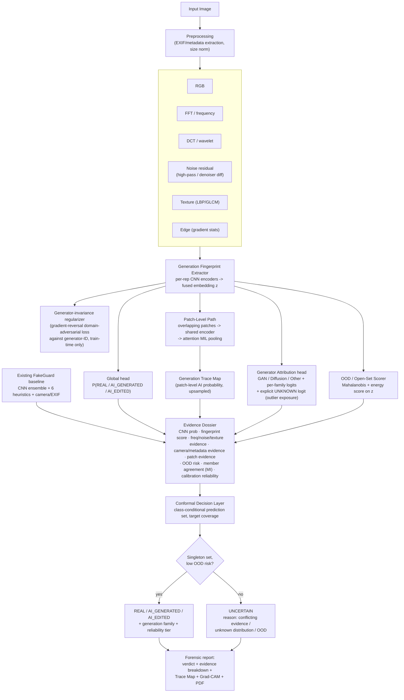

# Research Proposal: Generator-Independent Generation Fingerprint for AI Image Forensics

Status: **proposal only — no implementation yet.** This defines the research
methodology for the next-generation FakeGuard module before any code changes.
The current system (documented in [ARCHITECTURE.md](ARCHITECTURE.md) and
[PROJECT_SPEC.md](PROJECT_SPEC.md)) remains the baseline and is not removed or
replaced by anything below. This proposal is the mathematical/experimental
backbone for items already scoped at a higher level in
[RESEARCH_ROADMAP.md](RESEARCH_ROADMAP.md) (§4-§7, items A1-D1) — it does not
restate that document, it operationalizes the subset of it this project asked
for, as one coherent research contribution: **the Generation Fingerprint
module.**

Note on scope of the current baseline (important — avoids re-deriving what's
already built): the frozen-CLIP linear-probe ensemble member (roadmap item
A1) is **already implemented and live** (`backend/models/clip_detector.py`,
commit `4c59d04`). This proposal does not re-propose A1; it builds the next
layer on top of it — multi-representation fingerprinting, patch-level
localization, generator-independent evaluation, open-set detection, and
evidence-based decisioning — which are still unbuilt (roadmap items A2/A3,
B1/B2, C1, D1).

---

## 1. Research Gap

Documented directly against this codebase, not against the literature in the
abstract:

1. **The existing CNN ensemble learns generator-specific artifacts, not a
   general synthesis concept.** Measured in this project itself
   (`generate_diffusion_data.py`): before Stable Diffusion was added to
   training, both fine-tuned CNN members failed on it **identically** — 25/30
   confidently wrong, near-zero disagreement. Fine-tuning teaches "this
   generator's fingerprint," not "synthetic vs. real." Every retrain that adds
   a new generator to the training set narrows this gap for that generator
   and leaves the next one just as blind.
2. **REAL vs. AI_GENERATED vs. EDITED is a false trichotomy for the modern
   threat model.** A real photo with an AI-inpainted region (Generative Fill,
   face swap, object replacement) is neither "fully generated" nor a
   CASIA-style pixel splice. The system has no label and no training data for
   it today (`PROJECT_SPEC.md` Honest Status #1-#5 documents the EDITED class
   already losing recall to REAL — 0.866→0.665→0.573 — because two
   structurally different problems, synthesis and tampering, are forced into
   one softmax competing for probability mass).
3. **No mechanism exists for "I don't recognize this."** `UNCERTAIN` today is
   purely a confidence/MI threshold on a closed 3-class softmax — it cannot
   distinguish "genuinely ambiguous image" from "image unlike anything seen
   in training" (an unseen generator). Published work and this project's own
   measurement (item 1 above) agree that closed-set classifiers are
   systematically biased toward confidently misclassifying out-of-distribution
   synthetic images as REAL — the worst failure direction for a forensics
   tool.
4. **No systematic representation study exists.** The current heuristic stack
   (spectral decay, FFT periodicity, noise, texture, edges, ELA) was added
   incrementally, not evaluated as an ablation. There is no evidence for which
   of these six signals actually carries generator-independent information
   versus which only work in-distribution.
5. **Confidence is not tied to a coverage guarantee.** `MIN_CONFIDENCE=0.55`
   and `MAX_DISAGREEMENT=0.35` are hand-picked constants (flagged as
   unjustified in `RESEARCH_ROADMAP.md` §2.4). Nothing in the system today can
   state "predictions we answer carry ≤X% error at Y% coverage."

## 2. Novelty Statement

This is not "add more detectors." The claim under test is specific and
falsifiable:

> **A representation trained to be invariant to generator identity, while
> retaining discriminability between real and synthetic origin, generalizes
> to generators absent from training — measurably more than a representation
> trained only for REAL/FAKE classification on the same data.**

Concretely: instead of training a classifier that happens to generalize
(current baseline), directly optimize for generator-invariance as a training
objective, using a domain-adversarial regularizer where "domain" = generator
identity. The metric that matters is not held-out accuracy on known
generators (the current baseline already reports that) — it is **leave-one-
generator-out (LOGO) accuracy on a generator never seen during training**,
compared directly against the existing ensemble under the identical
protocol. If the fingerprint model does not beat the baseline on LOGO, the
research hypothesis is falsified and that negative result gets reported, not
hidden — consistent with how this project has handled every other measured
result to date (`PROJECT_SPEC.md` Honest Status).

Secondary novel contributions, each with its own falsifiable claim:

- **Patch-level MIL fingerprinting** generalizes whole-image synthesis
  detection to localized synthetic content (AI face on a real photo) without
  requiring a pixel-mask-labeled dataset for the localization signal itself —
  attention-pooled patch scores are supervised only by the image-level label.
- **Representation ablation** determines which of {RGB, FFT/DCT, noise
  residual, texture, edge} actually carry generator-independent signal, since
  the current system has never measured this per-representation, only
  per-heuristic in aggregate.
- **Evidence-dossier + conformal decision layer** replaces argmax-on-fused-
  softmax with a coverage-guaranteed abstention mechanism, converting
  "0.55 confidence" into "answered predictions carry ≤5% error at measured
  coverage."

## 3. Proposed Architecture



Everything left of `DOSSIER` is new. `BASE` is the existing, unmodified
ensemble + heuristic stack, feeding in as one more evidence source rather
than being replaced.

## 4. Mathematical / Technical Methodology

### 4.1 Multi-representation embedding

For image `I`, compute representations:

- `x_rgb = I`
- `x_freq = |FFT2D(I)|` (log-magnitude spectrum)
- `x_dct` = block-DCT coefficient histogram (8×8, JPEG-grid aligned)
- `x_noise = I - Denoise(I)` (fixed Gaussian/median denoiser residual — cheap,
  non-trained, same family as existing `blind_detector.py` noise heuristic
  but kept as a full residual map, not collapsed to a scalar)
- `x_texture` = LBP histogram map, local
- `x_edge` = Sobel gradient magnitude/orientation map

Each representation is encoded by a small shared-architecture CNN
`φ_k(x_k) → R^{d_k}` (lightweight — MobileNetV3-Small scale, not another
EfficientNet-B4, given the 4GB-laptop-GPU budget already established for this
project). Concatenate and project:

```text
z = W · [φ_rgb(x_rgb); φ_freq(x_freq); φ_dct(x_dct); φ_noise(x_noise);
         φ_texture(x_texture); φ_edge(x_edge)]   ∈ R^d
```

### 4.2 Generator-invariance objective

Let `y ∈ {REAL, AI_GENERATED, AI_EDITED}` be the task label and
`g ∈ {SD1.4, SDXL, DALLE3, Midjourney, ..., REAL}` be generator identity
(REAL images get their own "domain" too, so the regularizer doesn't
trivially collapse onto only the fake side). Two heads sit on top of `z`:

- Task head `h_y(z) → ŷ`, trained with standard cross-entropy `L_task`.
- Domain head `h_g(z) → ĝ`, trained through a **gradient reversal layer**
  (Ganin & Lempitsch, 2015): the domain head tries to predict generator
  identity from `z`; the encoder is updated to *maximize* that loss. Net
  effect: `z` becomes as uninformative about *which* generator produced the
  image as possible, while `L_task` still forces `z` to separate real from
  synthetic.

```text
L = L_task(h_y(z), y) − λ · L_domain(h_g(z), g)
```

`λ` ramped from 0 during warmup (standard DANN practice — an untrained
encoder produces domain-adversarial gradients that are pure noise early on).

This is the concrete, testable mechanism behind the novelty claim in §2: it
directly optimizes for the property being measured (LOGO generalization),
rather than hoping accuracy-on-training-generators happens to transfer.

### 4.3 Patch-level multi-instance path

Image tiled into `N` overlapping patches `{p_1...p_N}` (e.g. 128px, 50%
overlap). Each patch passes through the *same* fingerprint extractor
(weight-shared with the global path, not a separate network — keeps
parameter count and training cost bounded) to get `z_i`, then a per-patch
scalar fake-probability `s_i = σ(w^T z_i)`.

Attention-MIL pooling (Ilse et al., 2018 / CLAM-style):

```text
a_i = softmax_i( w_a^T tanh(V z_i) )
s_bag = Σ_i a_i · s_i
```

`s_bag` is trained against the image-level label only — no pixel masks
required for this signal. `{s_i}` reshaped to a spatial grid and upsampled
(bilinear) is the **Generation Trace Map**. Patches with high attention
weight *and* high `s_i` are the interpretable evidence for localized
synthetic content, directly supporting the "real face + AI background" case
in §6 of the original brief.

### 4.4 Generator attribution with explicit UNKNOWN

Attribution head `h_attr(z)` outputs a distribution over known generator
families **plus** an explicit UNKNOWN logit, trained via outlier exposure:
during each LOGO fold, the held-out generator's samples are used as
"UNKNOWN" negatives for the attribution head (never for the task head — the
task head must still say AI_GENERATED correctly on them). Report attribution
only when `max_softmax(h_attr) − p(UNKNOWN)` exceeds a calibrated margin;
otherwise emit `UNKNOWN GENERATOR` verbatim, per the brief's requirement.

### 4.5 Open-set / OOD scoring

Two complementary scores on the fused embedding `z`, computed against the
class-conditional feature statistics from training data (Lee et al., 2018;
Liu et al., 2020):

- **Mahalanobis distance** to the nearest class-conditional Gaussian
  `min_c (z − μ_c)^T Σ_c^{-1} (z − μ_c)`
- **Energy score** `E(z) = −log Σ_c exp(logit_c(z))`

High values on both → `OOD_risk = HIGH`, independent of whatever the softmax
confidence says — this is the mechanism behind the brief's example output
("AI Probability 91%, OOD Risk High → Manual Verification Required").

### 4.6 Evidence fusion and conformal decision layer

The dossier is not re-fused into a second learned softmax — deliberately, to
keep the decision auditable. It's a **Mondrian (class-conditional) conformal
predictor** (Angelopoulos & Bates, 2021) fitted on a held-out calibration
split, same split discipline as the existing `fit_calibration.py`:

```text
Given target error rate α (e.g. 0.05):
prediction_set(I) = { c : score_c(dossier(I)) ≥ q̂_{1-α, c} }
```

- Singleton set + low OOD risk → answer with the labeled class.
- Multi-element set → `UNCERTAIN`, reason = "conflicting forensic evidence."
- Empty set → `UNCERTAIN`, reason = "unknown image distribution" (this is
  the formal version of the OOD flag).

This directly replaces the current hand-picked `MIN_CONFIDENCE=0.55` /
`MAX_DISAGREEMENT=0.35` constants with a number that has a stated,
measurable guarantee, per RESEARCH_ROADMAP.md §6 (C1).

## 5. Dataset Requirements

Reusing and extending the existing `data/train` / `data/val` structure and
sampler machinery (`training/dataset.py::make_sampler`) rather than replacing
it — that machinery already solves class/sub-domain/category imbalance and
should carry over. Sources below are **verified by direct lookup** (name,
generator coverage, license, size, host — checked 2026-08-10), replacing an
earlier draft of this section that named datasets by reputation only
(GenImage/DiffusionDB/WildFake) without confirming what they actually contain
or how to get them. Two of those are kept below where verification held up;
the rest are replaced by better-matched, confirmed sources.

**AI_GENERATED — primary source: `ComplexDataLab/OpenFake` (HuggingFace).**
This is a direct hit for the LOGO protocol, not just a generic multi-generator
pool — it was built for exactly this evaluation shape. Confirmed coverage
includes **Flux (1.1-dev, 1.1-schnell, 2-dev, 2-klein)**, **SDXL variants**,
**DALL·E 3**, **Midjourney (6, 7)**, **Stable Diffusion 1.4-3.5**, plus newer
frontier models (Nano-Banana, Imagen 3/4, GPT Image). 2.46M images / 3.44TB
full — **do not bulk-download**; use `datasets` in streaming mode and filter
on the `model` column to pull a bounded sample per target generator (e.g.
1.5-2k images each for SDXL / DALL·E 3 / Midjourney 6-7 / Flux 1.1-dev / Flux
2-dev — enough for a training-side family plus a clean held-out LOGO fold,
without approaching the full 3.44TB). It also ships its **own held-out
OOD test split** — unseen generators paired with unseen real-image sources
(DOCCI, ImageNet) — which can be used as an independent second check on the
LOGO result, not just this project's own protocol. License: CC-BY-SA-4.0 for
open-weight subsets; **subsets from proprietary generators (Midjourney,
DALL·E, GPT-Image) are non-commercial-only** by the dataset's own terms —
fine for this research use, must stay flagged if this project is ever
monetized.

**AI_GENERATED — secondary/cross-check source: `Rajarshi-Roy-research/
Defactify_Image_Dataset` (HuggingFace, CC BY 4.0, fully commercial-clean).**
5 generators (Stable Diffusion 2.1, SDXL, Stable Diffusion 3, DALL·E 3,
Midjourney v6), built on MS-COCO real images, 96k images total, ~7.5GB,
pre-split 42k/9k/45k train/val/test. Small enough to pull in full where
OpenFake's proprietary-subset licensing is a concern, and useful as a second,
independently-sourced measurement of the same generators to sanity-check that
a LOGO result isn't an artifact of one dataset's collection quirks.

**AI_GENERATED — kept from the earlier draft, lower priority:** `GenImage`
(8 generators — SD1.4/1.5, GLIDE, VQDM, Wukong, BigGAN, ADM, Midjourney;
1.3M+1.35M images) adds real GAN-family diversity (BigGAN) that neither
source above has, which matters for the GAN-vs-diffusion generator-attribution
head (§4.4). Primary host is Baidu Yunpan (access friction outside China); a
partial Kaggle mirror exists (`renhuang8/genimage-subset-detection`) but its
exact contents weren't independently confirmed — verify what it actually
contains before relying on it, don't assume parity with the paper's full set.

**AI_EDITED — primary source: `DEFACTO` (Kaggle, gated — request-form
access).** Built on MS-COCO, four forgery types each with real ground-truth
masks: ~105k splicing, ~19k copy-move, ~25k object-removal/inpainting (each
paired with a separate inpaint-algorithm mask), ~40k face-morphing. This is
the localization ground truth §8 experiment #5 needs and CASIA (the current
EDITED source) does not provide. **Important gap to flag explicitly, not
paper over:** DEFACTO's "inpainting" subset uses classical object-removal
algorithms, not modern diffusion-based generative fill (SD-inpaint, Adobe
Generative Fill, Firefly) — it is a reasonable localization-training proxy,
not a claim that it covers today's dominant AI-editing threat.

**AI_EDITED — supplementary, locally produced:** run open inpainting models
(SD-inpaint, LaMa — `diffusers` is already a dependency via
`generate_diffusion_data.py`) against this project's own REAL pool, save the
inpaint mask at generation time. This is the piece that actually covers
modern generative-fill-style editing, and it's cheap (local compute, no API
cost) precisely because it reuses infrastructure this project already has.
Moderate volume (low thousands) is enough to seed the AI_EDITED-with-mask
category without a large time investment.

**REAL** (extend beyond the current face-majority + CASIA-Au/Indoor67/TextOCR
mix): needs explicit camera-model diversity for the camera-fingerprint
evidence line (§B2 in RESEARCH_ROADMAP.md), not just content diversity.
Candidate sources **Dresden Image Database** / **RAISE** were named in the
earlier draft on reputation (multi-camera, minimally-processed, standard in
the PRNU literature) but not independently re-verified in this pass — treat
as a lead to confirm, not a locked-in source, before committing storage
budget to it.

**Every image needs:** ground-truth label (REAL/AI_GENERATED/AI_EDITED),
generator identity where known (for LOGO folds and the attribution head,
§4.4), and edit mask where applicable (AI_EDITED only — DEFACTO and the
locally-produced inpaint set both provide this; CASIA's existing Tp masks
already do too and stay in use).

**New dependency:** `datasets` + `huggingface_hub` (pip) for the two HF
sources above — this project currently only pulls via the Kaggle API
(`download_data.py`). Small addition, same tier of dependency as `diffusers`
already is.

**Storage budget, concretely:** filtered OpenFake sample (~5-10k images) +
full Defactify (96k, 7.5GB) + a DEFACTO subset (subsampled, a few thousand
per forgery type rather than the full ~189k) + a locally-generated inpaint
set (low thousands) lands in the tens-of-thousands-of-images / low-tens-of-GB
range added to the existing ~34k-image `data/` tree — not the 3.44TB ceiling
OpenFake's full release would otherwise imply. This needs an explicit
disk-space check on this machine before pulling anything, and DEFACTO's
request-form gate needs a human to submit it — neither step is scriptable
end-to-end the way `download_data.py`'s existing Kaggle sources are.

## 6. Model Architecture (summary table)

| Component | Architecture | Params (approx) | Trained? |
|---|---|---|---|
| Per-representation encoders (×6) | MobileNetV3-Small-scale CNN | ~2.5M each | yes, from scratch or ImageNet-init |
| Fusion projection | Linear + LayerNorm | negligible | yes |
| Task head | 2-layer MLP | negligible | yes, cross-entropy |
| Domain-adversarial head | 2-layer MLP + GRL | negligible | yes, adversarial |
| Patch MIL head | shared encoder + attention pooling | negligible extra | yes |
| Attribution head | linear + UNKNOWN logit | negligible | yes, outlier exposure |
| OOD scorer | non-parametric (Mahalanobis/energy) on z | none | fit, not trained |
| Conformal layer | quantile lookup | none | calibrated, not trained |

Total new trainable parameter budget stays well under the existing
EfficientNet-B4 member alone (~19M params) — deliberately, given the
project's demonstrated hardware ceiling (4.3GB laptop GPU, `--batch-size 8
--grad-accum-steps 4`).

## 7. Training Strategy

1. **Stage 1 — fingerprint extractor.** Train `φ_k` + task head + domain-
   adversarial head jointly on all known generators, `λ` ramped per §4.2.
   Two-phase schedule matching the existing `train.py` pattern (freeze →
   unfreeze, cosine LR).
2. **Stage 2 — patch/attribution/OOD heads.** Freeze the extractor from
   stage 1, train the MIL patch head and attribution head on top (cheap —
   linear/small-MLP heads only, matches the existing CLIP-probe training
   cost profile already validated in this project).
3. **Stage 3 — calibration.** Fit Mondrian conformal quantiles + reliability
   diagrams on a held-out split disjoint from stages 1-2, same split
   discipline `fit_calibration.py` already uses.
4. **LOGO protocol, repeated K times** (K = number of generator families):
   each fold excludes one family entirely from stages 1-3, evaluates
   zero-shot on it. This is the primary experiment (§8) and must be run
   before any promotion decision, exactly like `evaluate_by_category.py`'s
   role in the existing pipeline.

## 8. Evaluation Protocol

Directly implements the 11 experiments requested in the brief, each mapped
to a concrete script (naming follows the existing `training/evaluate_*.py`
convention):

| # | Experiment | Script (new) | Primary metric |
|---|---|---|---|
| 1 | Known-generator detection | `evaluate_known_gen.py` | accuracy/F1 per family |
| 2 | Cross-generator detection | `evaluate_cross_gen.py` | accuracy on family B after training on A |
| 3 | Unseen-generator (LOGO) | `evaluate_logo.py` | accuracy/AUC on fully held-out family — **primary claim metric** |
| 4 | AI-edited real-image detection | `evaluate_ai_edited.py` | recall on AI_EDITED class |
| 5 | AI-region localization | `evaluate_localization.py` | patch-map IoU / AUROC vs. edit masks |
| 6 | JPEG/compression robustness | extend existing `robustness_eval.py` | accuracy delta vs. quality factor |
| 7 | Screenshot robustness | extend `robustness_eval.py` | accuracy delta |
| 8 | Social-media transform robustness | extend `robustness_eval.py` | accuracy delta after re-save chain |
| 9 | Unknown/OOD detection | `evaluate_ood.py` | AUROC(known vs. LOGO-held-out as OOD proxy) |
| 10 | Ablation of representations | `evaluate_ablation.py` | LOGO accuracy per representation subset |
| 11 | Baseline comparison | `evaluate_vs_baseline.py` | fingerprint module vs. existing ensemble, same protocol, same test sets |

## 9. Baseline Comparison

The existing ensemble + heuristic stack (`ensemble.py`, `blind_detector.py`,
`fusion.py` together) is `B0`. All experiments in §8 run `B0` and the new
fingerprint module (`F1`) through the identical LOGO / robustness / ablation
protocol, on the same held-out splits. The claim in §2 is validated **only**
if `F1` beats `B0` on experiment #3 (LOGO) by a margin outside what could be
explained by noise (bootstrap CI over the test set). In-distribution accuracy
(experiment #1) is tracked as a guardrail — `F1` must not regress materially
there even if LOGO improves, since the point is generalization *in addition
to*, not *instead of*, known-generator accuracy.

## 10. Ablation Experiments

Representation ablation (§8 #10) is the one explicitly called out by the
brief as not-to-be-assumed: train and LOGO-evaluate the fingerprint extractor
with each representation subset — `{RGB}`, `{RGB+freq}`, `{RGB+freq+noise}`,
..., full set — holding the domain-adversarial objective and everything else
fixed. Report LOGO accuracy per subset. If, e.g., texture contributes nothing
once frequency + noise are present, that gets reported and texture gets
dropped from the shipped module — consistent with this project's existing
practice of recording negative results (ConvNeXt retrain, TTA views) rather
than keeping dead weight.

Secondary ablations: with/without domain-adversarial term (isolates whether
the invariance objective itself is doing the work, vs. just more data/capacity);
with/without patch-MIL path (isolates its contribution to whole-image
accuracy, separate from its localization value).

## 11. Expected Contribution

1. A measured answer to the central research question — whether
   generator-invariance as an explicit training objective transfers better
   to unseen generators than the current supervised approach, with the LOGO
   protocol as reusable infrastructure for every future retrain.
2. Patch-level generation trace mapping for localized synthetic content,
   filling the "real photo + AI region" gap the current 3-class head cannot
   express.
3. An explicit open-set / UNKNOWN-generator pathway, converting the current
   system's most dangerous failure mode (confident wrong answer on novel
   generators) into a flagged, actionable UNCERTAIN.
4. A representation-contribution study answering which of RGB/frequency/
   noise/texture/edge actually matter for generalization — currently
   unmeasured in this codebase.
5. A conformal, coverage-guaranteed decision layer replacing hand-tuned
   thresholds, with a stated error rate rather than an assumed one.
6. This proposal's LOGO + ablation + robustness protocol is itself a
   contribution independent of whether `F1` beats `B0` — per §9, a rigorous
   negative result is reported as such, not hidden.

## 12. Limitations

- **Compute ceiling.** This project trains on a 4.3GB laptop GPU. Reconstruction-
  error / diffusion-inversion methods (roadmap A2) are out of scope for this
  phase on cost grounds (~1-3s/image inversion pass); the fingerprint module
  proposed here is discriminative, not reconstruction-based.
- **Generator coverage is bounded by public dataset access, not live API
  generation.** True FLUX/Midjourney-v7/Firefly-v4 samples come from public
  research datasets scraped/released by others, not fresh generation against
  paid APIs — coverage and recency are limited by what those datasets
  contain, not by the method.
- **Camera-fingerprint evidence (PRNU-style) degrades under heavy platform
  re-compression** — a documented property of the underlying signal, not a
  gap specific to this system; the evidence dossier must weight it low when
  metadata indicates multiple re-saves.
- **Generator attribution is inherently capped**, not just by data — newer
  diffusion architectures converge toward similar spectral statistics as
  training-data/objective choices converge, so fine-grained attribution
  (e.g. SDXL vs. FLUX specifically) may plateau below family-level
  (GAN vs. diffusion) accuracy. The explicit UNKNOWN pathway exists precisely
  because this is expected, not a bug to be trained away.
- **Adversarial robustness is explicitly out of scope for this proposal**
  (tracked separately as roadmap item C2) — this work targets benign
  distribution shift (unseen generators, compression, re-saves), not an
  adaptive adversary.
- **No accuracy target is claimed in advance.** Per the brief's own
  instruction, this proposal commits to reporting whatever the LOGO numbers
  actually are, including a null result on the core hypothesis, rather than
  asserting a target percentage before the experiment runs.

## 13. On "pixel-level classifiers" (Hive, TruthScan, Sightengine)

These are closed-source commercial detectors — proprietary models behind a
paid API, no published architecture or training data, no way to inspect or
reproduce what they measure. They are not something this research can
integrate as a *component* (no local model, no transparency into method,
ongoing per-call cost, ToS restrictions on redistributing their outputs).

What this proposal does instead: §4.3's patch-level MIL path *is* the local,
inspectable equivalent — a per-patch, pixel-neighborhood-level probability
map trained on this project's own data, producing the same kind of
fine-grained signal those commercial tools produce, but locally trained,
free to run, and fully explainable (attention weights + per-patch scores are
inspectable, unlike a commercial API's opaque score). If a budget-gated,
optional comparison against a commercial API's output is later wanted purely
as an external reference point in the evaluation section (§8), that's a
small, separable addition — not a dependency of the core method.

---

## Next Steps

This was written as a proposal-before-implementation. At the user's explicit
direction to proceed on all fronts, steps 1-3 below are now running in
parallel rather than strictly sequenced — flagged here so that deviation is
visible, not silent, consistent with this project's existing practice of
recording what actually happened rather than what the plan said would
happen (see PROJECT_SPEC.md Honest Status).

1. **Dataset acquisition (§5) — in progress.** `training/download_research_data.py`
   written and verified against real schemas (Defactify's `Label_B` generator-ID
   column, OpenFake's `model` column — both confirmed by direct inspection,
   not assumed from documentation). Defactify pull running in the background
   as of this session. OpenFake model-string list still pending — its exact
   filter strings in `OPENFAKE_TARGET_MODELS` were written from the dataset
   card's prose description, not yet confirmed against the real `model`
   column values; run `--source list-openfake-models` and cross-check before
   trusting an OpenFake pull's bucket counts. DEFACTO (AI_EDITED ground-truth
   masks) still blocked on its Kaggle request-form gate — that step needs a
   human, not a script.
2. **Baseline LOGO number — in progress, not yet complete.** No surviving
   checkpoint predates SD1.4 being added to training (see Honest Status-style
   finding: the checkpoint backups on disk all post-date it), so the
   documented 0/30 result in `generate_diffusion_data.py` isn't independently
   reproducible from what's on disk. A fresh StyleGAN-only retrain
   (`--exclude-prefix sd14_`, background) is running to produce a scriptable,
   n=200 replacement number via `evaluate_by_category.py`'s existing
   `ai_generated/sd14` row.
3. **Stage 1 implementation (§7) — architecture complete, training not yet
   run.** `models/fingerprint/` (representations, encoder, GRL, patch MIL,
   OOD scorer) and `training/{fingerprint_dataset,train_fingerprint,
   evaluate_fingerprint_logo}.py` are written and smoke-tested
   (`training/test_fingerprint_module.py` — forward, backward through the
   GRL, patch MIL, and OOD scoring all verified against random data). Not yet
   run against real data: needs step 1's multi-domain pull to finish first,
   since a LOGO training run needs the domains it's supposed to hold out to
   actually exist on disk. `ensemble.py` / `fusion.py` remain untouched — the
   live system is still exactly the 3-member CNN ensemble + heuristics
   baseline until a fingerprint checkpoint has a validated LOGO number to
   justify wiring it in.
