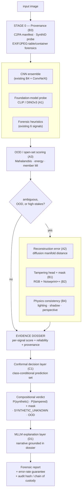

# FakeGuard AI — Research Gap Analysis & Next-Generation Roadmap

Written against the system as it actually exists (commit `27795cc`), not against
its documentation. Read [ARCHITECTURE.md](ARCHITECTURE.md) for how the current
system works and [PROJECT_SPEC.md](PROJECT_SPEC.md) for its known limitations.

**Framing:** the biggest problem with this system is not a missing feature. It
is that the *paradigm* it is built on — supervised CNNs fine-tuned on a fixed
set of generators — has a known, measured ceiling on exactly the thing you say
you care about (unseen generators). No amount of retraining the current stack
breaks that ceiling. Sections 2 and 3 make that case with evidence; sections
4-7 propose what to build instead.

---

## 1. What you already have that is genuinely strong

Stating this precisely, because two of these are more valuable than you may
realize and the proposals below build on them rather than replacing them.

| Asset | Why it matters |
|---|---|
| **Epistemic/aleatoric uncertainty decomposition** (`ensemble.py`) | Most detection systems report a single softmax number. Decomposing predictive entropy into aleatoric + mutual information, and abstaining on MI, is methodologically ahead of most published detectors. This is the correct foundation for everything in §6. |
| **Deliberate architectural diversity for decorrelated errors** | ConvNeXt-Tiny @224 + EfficientNet-B4 @380 was chosen so members fail differently. Correct reasoning, and it makes the MI term meaningful instead of degenerate. |
| **Measured shortcut-learning case study with a documented fix** | You have hard numbers showing a model that learned "not a face → EDITED", the sub-domain-balanced sampler that fixed it, and per-category before/after metrics across three granularities. **This is a publishable contribution on its own** — see §8. |
| **Honest negative results kept in the repo** | ConvNeXt retrain measured, rejected, recorded. TTA views measured harmful, reverted with the numbers. This is rarer than it should be and it is what makes the project defensible under review. |
| **Resample-free TTA reasoning** (`tta.py`) | The insight that forensic evidence lives in high-frequency content that interpolation destroys is correct and under-appreciated in the literature. |

Keep all of it. Nothing below asks you to throw these away.

---

## 2. Limitations of the current system

Grouped by severity, each grounded in your own code or measurements.

### 2.1 Existential: the training distribution is three generator-generations out of date

`ai_generated` is StyleGAN (140k dataset, ~2019 tech) + 800 Stable Diffusion
1.4/2.1 images from `generate_diffusion_data.py`. That is the entire synthesis
prior the models have.

A 2026 zero-shot benchmark of 16 SOTA detection methods across 291 generators
found that **Flux Dev, Firefly v4, and Midjourney v7 are detected at only
18–30% average accuracy** — and those are methods explicitly designed for
generalization ([benchmark study](https://arxiv.org/html/2602.07814v1)). Your
detector has strictly less generator diversity in training than the methods in
that study. Its realistic accuracy on current-generation output is likely at or
below chance, and — critically — your `generate_diffusion_data.py` docstring
records that when this happened before (StyleGAN-only → SD images), the failure
was **confidently wrong with near-zero member disagreement**. Both members
shared the blind spot, so abstention did not fire. That exact failure mode is
live again for Flux/MJv7/Firefly-class generators.

### 2.2 Architectural: one 3-class head is solving two unrelated problems

`REAL | AI_GENERATED | EDITED` forces a single softmax to jointly answer:

- **Synthesis detection** — was this image *generated*? Evidence: global
  frequency statistics, upsampling fingerprints, texture priors. Whole-image,
  low-frequency-robust.
- **Tampering detection** — was this *real photo* locally modified? Evidence:
  local noise/compression/CFA inconsistency at a boundary. Spatially sparse,
  destroyed by re-compression.

These have different evidence, different spatial scales, and different failure
modes. Forcing them into mutually exclusive classes is why **`edited/Tp_S`
recall has fallen 0.866 → 0.665 → 0.573 across your last two promotions** while
real-photo categories improved. That is not a tuning problem you can sampler-
balance your way out of — the classes are competing for the same probability
mass, so every gain on REAL non-face photos is extracted from EDITED. It is a
structural consequence of the label design, and it is the single highest-value
architectural fix available to you (§5.1).

It also leaves a gap with no label at all: **AI inpainting** (a real photo with
an AI-generated region — SDXL inpaint, Firefly Generative Fill). It is neither
"fully generated" nor a CASIA-style splice, and it is arguably the dominant
real-world manipulation threat today. Your system has no class for it and no
training data containing it.

### 2.3 Forensic: Grad-CAM is not evidence

`gradcam.py` produces class-activation saliency from B4's last conv block. That
answers "which region most influenced the classifier's logit" — it does **not**
answer "which pixels were manipulated." Those are different claims, and only
the second is forensically meaningful. Saliency maps are known to be
unreliable as evidence (they can be insensitive to model parameters under
randomization tests — Adebayo et al., "Sanity Checks for Saliency Maps",
NeurIPS 2018).

For a forensics platform this is the gap between "the model thinks it's fake"
and "here is the tampered region, with a confidence map" — the latter is what
`TruFor` and `MVSS-Net++` produce and what an investigator can actually act on.

### 2.4 Reliability: abstention thresholds are unjustified constants

`MIN_CONFIDENCE = 0.55` and `MAX_DISAGREEMENT = 0.35` are hand-picked. They
carry no guarantee: you cannot state an error rate for the answers the system
*does* give. For research or forensic use, "we abstain when MI > 0.35" is not
defensible; "our answered predictions carry ≤5% error at 90% coverage, with a
distribution-free guarantee" is. See §6.1.

Related: temperature is fitted on in-distribution val data. Calibration is
known to break under distribution shift, which is precisely the regime the
system will be deployed in.

### 2.5 Security: zero adversarial consideration

`robustness_eval.py` covers JPEG, blur, downscale, noise — benign degradation.
It does not cover an *adversary*. Published results show detectors dropping to
**0% accuracy under imperceptible adversarial perturbations**, and that these
perturbations survive compression
([Adversarial Deepfakes](https://arxiv.org/pdf/2002.12749),
[Exposing Vulnerabilities](https://dl.acm.org/doi/10.1145/3464307)). Anyone
motivated to defeat your system can, trivially, today.

### 2.6 Correctness issues found during review

| Location | Issue |
|---|---|
| `fusion.py` docstring | Claims "CNN (val macro-F1 ~0.99) dominates" — actual current val macro-F1 is **0.862**. The 0.99 was the shortcut-inflated number from before the non-face fix. Stale by two promotions. |
| `comparative_detector.py:87` | `is_manipulated = score < 0.95 or len(significant) > 0 or phash_distance > 10` — an OR of three loose thresholds. Any JPEG re-save shifts SSIM below 0.95 and produces contours >200px. This will report **manipulated on virtually any re-compressed but unedited image**. High false-positive rate by construction. |
| `comparative_detector.py:55` | Suspect image is resized to the original's dimensions and compared pixel-wise. No geometric registration — any crop, shift, or rotation makes the pixel diff meaningless while still tripping the threshold above. |
| `blind_detector.py` ELA | ELA is a legacy heuristic, weak on modern re-saves and near-useless on non-JPEG pipelines. It carries weight in the 0.15 heuristic share regardless. |

---

## 3. Gap versus current research

| Capability | SOTA (2023–2026) | Your system |
|---|---|---|
| Generalization to unseen generators | Foundation-model features (CLIP/DINOv3) + light head; anomaly/manifold formulations | Supervised CNNs fine-tuned on a fixed, dated generator set |
| Zero-shot diffusion detection | Reconstruction-error methods (DIRE, AEROBLADE, MIRROR) | None |
| Forgery localization | Pixel-level masks + confidence maps (TruFor, MVSS-Net++, EDGER) | Grad-CAM saliency only |
| Camera/source forensics | Learned camera-model fingerprints (Noiseprint++), PRNU | Handcrafted noise-residual score |
| Provenance | C2PA + SynthID, now adopted by OpenAI, Google, Nvidia, Meta | None |
| Explanation | MLLM reasoning over artifacts (FakeShield ICLR'25, SIDA CVPR'25, ForgeryGPT) | Numeric signal scores + saliency |
| Risk control | Conformal prediction, OOD scoring | Fixed thresholds |
| Adversarial robustness | Active research area, acknowledged as unsolved | Not considered |
| Attribution | Generator attribution / model fingerprinting | None |

---

## 4. Proposals — Theme A: generalization to unknown generators

### A1. Foundation-model feature space as the primary detection backbone

**1. Problem it solves.** Detecting images from generators that did not exist
at training time — Flux, MJ v7, Firefly v4, and whatever ships next quarter.

**2. Why current systems fail.** A CNN fine-tuned end-to-end on
{StyleGAN, SD1.4} learns *those* generators' specific artifacts (upsampling
signatures, texture statistics). Those artifacts are architecture-specific and
change with every generator generation, so the learned features do not
transfer. The key published finding is that features from a large pretrained
vision model — *never trained on the detection task* — separate real from
generated far more generally, because they encode a broad prior over natural
image statistics rather than one generator's fingerprint. UnivFD
([Ojha et al., CVPR 2023](https://arxiv.org/abs/2302.10174)) showed a linear
probe on frozen CLIP features beating heavily-trained detectors on unseen
generators; work through 2026 continues in this direction
([CLIP-Flow](https://arxiv.org/pdf/2508.09477),
[MiraGe](https://arxiv.org/pdf/2508.01525),
[DINOv3 cross-generator](https://arxiv.org/pdf/2511.22471)).

**3. Integration.** Add as a **third ensemble member** in
`ensemble.py::MEMBER_SPECS` — the code already renormalizes weights over
whichever members load, so this is a natural extension. Freeze the CLIP/DINOv3
backbone, train only a linear or 2-layer probe on your existing data. Cheap:
extract features once, train the head in minutes on your 3050 Ti, no backbone
gradients. Because it fails *very* differently from two ImageNet-supervised
CNNs, it also makes your mutual-information term substantially more
informative — the abstention mechanism gets better for free.

**4. Expected improvement.** This is the single highest-leverage change
available. Published cross-generator gains are large (frequently 20–40 points
of accuracy on unseen generators versus supervised CNNs). It also directly
addresses the failure recorded in your own `generate_diffusion_data.py` — a
blind spot both current members share.

**5. References.** UnivFD (CVPR 2023); Cozzolino et al., "Raising the Bar of
AI-generated Image Detection with CLIP" (2024);
[MiraGe](https://arxiv.org/pdf/2508.01525);
[Rethinking Cross-Generator Detection through DINOv3](https://arxiv.org/pdf/2511.22471).

---

### A2. Reconstruction-error branch for zero-shot diffusion detection

**1. Problem it solves.** Detecting diffusion-generated images from models you
have *no training samples for at all* — including models released after
deployment.

**2. Why current systems fail.** Discriminative classifiers need examples of
the target class. Reconstruction methods sidestep this entirely: pass the image
through a pretrained diffusion autoencoder / inversion process and measure how
well it reconstructs. Diffusion-generated images lie *on* the model's learned
manifold and reconstruct with low error; real photographs do not. The signal
requires **zero labelled examples of the specific generator** — it is a
property of generated images in general. DIRE
([Wang et al., ICCV 2023](https://arxiv.org/abs/2303.09295)) established this;
AEROBLADE and 2026's [MIRROR](https://arxiv.org/pdf/2602.02222) refine it.

**3. Integration.** New module `models/reconstruction_detector.py`, exposing a
scalar "manifold distance" score. Feed it into `fusion.py` as a **third
evidence stream** alongside CNN and heuristics (see §7 for the revised fusion).
You already have `diffusers` in `requirements.txt` from
`generate_diffusion_data.py`, so the dependency is paid for. Note the cost: an
inversion pass is expensive (~1–3s/image on your GPU), so gate it — run it only
when the fast path is uncertain, which your abstention logic already computes.
That gating is itself a nice contribution.

**4. Expected improvement.** Coverage of the "future/unknown generator" case
that discriminative training structurally cannot reach. Combined with A1, this
gives you two independent unseen-generator mechanisms, which is what makes an
ensemble's disagreement signal trustworthy in the open-set regime.

**5. References.** DIRE (ICCV 2023); AEROBLADE (CVPR 2024);
[MIRROR](https://arxiv.org/pdf/2602.02222);
[GenDet anomaly-detection framing](https://arxiv.org/pdf/2312.08880).

---

### A3. Reformulate as open-set recognition, not closed 3-class classification

**1. Problem it solves.** The system currently *cannot* say "this is
synthetic, but from something I don't recognize." Every input is forced into
REAL / AI_GENERATED / EDITED. UNCERTAIN is a confidence-threshold artifact, not
a semantic category.

**2. Why current systems fail.** Closed-set softmax assigns probability mass
across known classes only; it has no vocabulary for "outside the training
manifold." Published work notes detectors carry **a strong bias toward
classifying out-of-domain inputs as real** — the worst possible failure
direction for a forensics tool, and exactly what your own SD-blindspot
measurement showed (25/30 confidently REAL).

**3. Integration.** Add an explicit OOD score alongside the existing MI term —
Mahalanobis distance to class-conditional feature means, or energy-based OOD
scoring, computed on the A1 foundation-model features. Extend the output
vocabulary from `{REAL, AI_GENERATED, EDITED, UNCERTAIN}` to include
**`SYNTHETIC_UNKNOWN_SOURCE`** (high synthesis evidence, low similarity to any
known generator) and **`OUT_OF_DISTRIBUTION`** (unlike anything in training —
handle manually). This is a change in `blind_detector.analyze()`'s decision
logic plus a small addition to `ensemble.py`.

**4. Expected improvement.** Converts the most dangerous failure mode
(confidently-wrong REAL on a novel generator) into an actionable flag. For
forensic deployment this is worth more than accuracy points — a flagged unknown
gets human review; a confident false REAL does not.

**5. References.** Liu et al., "Energy-based Out-of-distribution Detection"
(NeurIPS 2020); Lee et al., Mahalanobis OOD (NeurIPS 2018);
[GenDet](https://arxiv.org/pdf/2312.08880);
[Where Detectors Fail](https://arxiv.org/html/2605.24906v2).

---

## 5. Proposals — Theme B: forensic-grade evidence

### B1. Split the head: separate synthesis detection from tampering localization

**1. Problem it solves.** The `Tp_S` erosion you have been fighting all along
(0.866 → 0.665 → 0.573), and the missing AI-inpainting category.

**2. Why current systems fail.** Covered in §2.2 — one softmax, two problems,
competing probability mass. Most published work treats these as separate tasks
for exactly this reason: synthesis detection benchmarks (GenImage, ForenSynths)
and localization benchmarks (CASIA, IMD2020, Columbia) are separate literatures
with separate architectures.

**3. Integration.** Restructure into two heads over the shared evidence:

- **Head 1 — Synthesis:** `P(fully generated)` — CNN ensemble + A1 + A2.
- **Head 2 — Tampering:** `P(locally manipulated)` + **a pixel mask** —
  segmentation model (TruFor-style, RGB + learned noise fingerprint).

Outputs become compositional rather than mutually exclusive, which lets you
express **AI-inpainted** naturally: low synthesis score globally + high
tampering score locally + generated-texture statistics inside the mask. No new
class collision. `fusion.py` combines the heads into a report rather than a
single argmax; the API response gains a `manipulation_mask_url`.

**4. Expected improvement.** Removes the structural cause of the recall
trade-off — the two objectives stop competing. Adds a genuinely new detection
capability (AI inpainting). Produces an actual forensic artifact (a mask)
instead of saliency.

**5. References.** [TruFor, CVPR 2023](https://grip-unina.github.io/TruFor/)
(RGB + Noiseprint++ + confidence map); MVSS-Net++;
[EDGER](https://arxiv.org/pdf/2605.12002);
[DiffusionPrint](https://arxiv.org/pdf/2604.12443) (diffusion-inpainting
localization); [SIGMA](https://arxiv.org/pdf/2605.27924).

---

### B2. Learned camera-model fingerprint (Noiseprint++) replacing the noise heuristic

**1. Problem it solves.** Source-device attribution, and splice localization
that survives the conditions your handcrafted noise-residual score does not.

**2. Why current systems fail.** Your `_noise_residual_score` is a global
scalar from a handcrafted filter. A *learned* camera-model fingerprint is a
spatially-structured residual that suppresses scene content and amplifies
device-specific traces — so a spliced region imported from a different camera
shows as a fingerprint discontinuity, localized. This is a materially stronger
signal, and it is what TruFor's localization is built on.

**3. Integration.** `models/camera_fingerprint.py` producing a residual map;
consumed by B1's tampering head as an input channel, and surfaced as its own
evidence line in the report ("noise fingerprint inconsistent in region X").

**4. Expected improvement.** Real localization capability on splices; opens
device-level attribution ("consistent with a single capture device" vs.
"composite of ≥2 sources"), which is a forensic claim your system currently
cannot make at all.

**5. References.** Cozzolino & Verdoliva, "Noiseprint: a CNN-based camera
model fingerprint" (IEEE TIFS 2020); Noiseprint++ within TruFor; Lukáš et al.,
PRNU sensor fingerprints (2006) for the classical baseline.

---

### B3. Active provenance layer — C2PA, SynthID, and container forensics

**1. Problem it solves.** A large and rapidly growing fraction of AI images can
be identified with near-certainty *without any model inference at all*.

**2. Why current systems fail.** Purely passive systems ignore free, high-
precision evidence. As of 2026 this evidence is substantial: OpenAI ships C2PA
manifests **plus** SynthID watermarks on ChatGPT/API/Codex images (announced
May 2026); Google has watermarked **100B+ files** with SynthID; C2PA adopters
now include OpenAI, Nvidia, Kakao, ElevenLabs; Pixel 8/9/10 embed Content
Credentials at capture; Instagram auto-labels via Meta; C2PA/SynthID
verification is landing in Google Search and Chrome
([1](https://c2paviewer.com/articles/openai-google-c2pa-synthid-2026),
[2](https://www.eyesift.com/ai-image-detection-2026-c2pa-content-credentials-synthid-watermarks-diffusion-fingerprints-deepfake/)).

Ignoring this is leaving the highest-precision signal in the field unused.

**3. Integration.** New pre-inference stage in `routers/detect.py`, before
`blind_detector.analyze()`:

1. **C2PA manifest** — present? valid signature? what does it assert?
2. **SynthID / watermark probe** — where detector APIs are available.
3. **Container & metadata forensics** — EXIF consistency, JPEG quantization
   table fingerprinting, thumbnail-vs-image mismatch, double-compression
   traces, software tags. Classical, cheap, forensically standard, and
   completely absent from your system.

Critically: treat this as **evidence, not verdict**. Absence of a C2PA manifest
proves nothing (most tools don't emit one, and manifests are strippable);
presence of a valid one is strong. This asymmetry must be explicit in the
fusion logic — see §7.

**4. Expected improvement.** Near-certain identification for a growing share of
inputs, at negligible compute cost. Also a strong differentiator for
commercial/competition framing: hybrid active+passive is where the industry is
actually heading.

**5. References.** C2PA specification; Google SynthID; Fernandez et al.,
"The Stable Signature" (ICCV 2023); Wen et al., "Tree-Ring Watermarks"
(NeurIPS 2023);
[C2PA/SynthID 2026 adoption status](https://c2paviewer.com/articles/verify-ai-generated-image-c2pa-synthid).

---

### B4. Physics and semantic consistency checks

**1. Problem it solves.** Detection that survives heavy re-compression, resizing
and social-media laundering — the conditions that destroy every low-level
signal your system currently relies on.

**2. Why current systems fail.** Spectral decay, GAN periodicity, ELA, noise
residual, and CNN texture cues **all** live in high-frequency content. Your own
`robustness_eval.py` measures the consequence. Physics-based inconsistencies —
lighting direction disagreement between subjects, shadow geometry that doesn't
converge, impossible perspective, reflection mismatch — are *semantic* and
therefore survive compression almost intact. They are also nearly impossible
for a generator to get right by construction.

**3. Integration.** `models/physics_consistency.py` as a fourth evidence
stream: estimate per-object lighting direction and test for mutual consistency;
check shadow-to-light-source geometry; check vanishing-point consistency. Runs
independently of the CNN path.

**4. Expected improvement.** Coverage of the laundered-image regime where your
current stack degrades most. Also intrinsically explainable — "the shadow under
the car points 40° away from the shadow under the person" is a statement an
investigator, a judge, or a competition judge immediately understands.

**5. References.** Farid, *Photo Forensics* (MIT Press, 2016) — the canonical
treatment; Kee, O'Brien & Farid, "Exposing Photo Manipulation from Shading and
Shadows" (ACM TOG 2014); Farid, "Lighting (In)consistency" line of work.

---

## 6. Proposals — Theme C: reliability and risk control

### C1. Conformal prediction — replace magic thresholds with a coverage guarantee

**1. Problem it solves.** Turning "0.55 confidence / 0.35 MI" into a stated,
verifiable error rate. This is the difference between a demo and an instrument.

**2. Why current systems fail.** Almost all detection papers report accuracy on
a test set and stop. They cannot answer "what is the error rate on *this*
prediction?" Conformal prediction provides distribution-free, finite-sample
coverage guarantees: choose α = 0.05 and the prediction *set* contains the true
class ≥95% of the time, with no distributional assumptions. Singleton set →
confident answer. Multi-class set → genuine ambiguity, quantified. Empty set →
outside the calibration distribution entirely (ties directly into A3).

**3. Integration.** Extends what you already have. `fit_calibration.py` already
holds out half the val set — fit conformal quantiles on the same split.
`ensemble.py`'s abstention becomes: abstain iff the conformal prediction set is
not a singleton. `MIN_CONFIDENCE` / `MAX_DISAGREEMENT` become derived, not
chosen. Add **Mondrian (class-conditional) conformal** so REAL and EDITED get
separate guarantees — directly relevant to your Tp_S recall problem, since it
lets you control EDITED's error rate independently of REAL's.

**4. Expected improvement.** Statistically defensible outputs. This is the
single change that most improves *research and forensic credibility* per unit
of work — the machinery is small, the claim it licenses is large. Also
addresses Daubert-style admissibility, which requires a **known error rate**;
courts are already grappling with deepfake evidence standards.

**5. References.** Angelopoulos & Bates, "A Gentle Introduction to Conformal
Prediction and Distribution-Free Uncertainty Quantification" (2021); Vovk et
al., *Algorithmic Learning in a Random World*;
[Robust and Calibrated Detection of Authentic Multimedia Content](https://arxiv.org/pdf/2512.15182).

---

### C2. Adversarial robustness — measure it, then harden

**1. Problem it solves.** An adversary who wants to defeat your system
currently can, with imperceptible perturbations that survive JPEG.

**2. Why current systems fail.** Benign-degradation robustness (what
`robustness_eval.py` measures) and adversarial robustness are different
properties; the first does not imply the second. Published results show SOTA
detectors collapsing to **0% accuracy** under attack, with perturbations robust
to compression codecs.

**3. Integration.** Two parts:

- **Measure** — extend `robustness_eval.py` with an adversarial suite:
  white-box PGD against your ensemble, transfer attacks from a surrogate,
  and — most important practically — **laundering chains** (upload → resize →
  re-compress → screenshot → re-upload). Publish the numbers honestly, as you
  have with everything else.
- **Harden** — randomized smoothing over your existing TTA, input
  preprocessing/purification, adversarial fine-tuning on a fraction of the
  data. Note the ensemble helps here already: attacking two architectures at
  two resolutions simultaneously is harder than attacking one.

**4. Expected improvement.** Converts an unknown, unbounded risk into a
measured one. An honest adversarial evaluation section is also frequently what
separates a publishable systems paper from a rejected one.

**5. References.** Carlini & Farid, "Evading Deepfake-Image Detectors with
White- and Black-Box Attacks" (CVPRW 2020);
[Adversarial Deepfakes](https://arxiv.org/pdf/2002.12749);
[Exposing Vulnerabilities of Deepfake Detection Systems](https://dl.acm.org/doi/10.1145/3464307);
Cohen et al., randomized smoothing (ICML 2019).

---

### C3. Continual adaptation to new generators without full retraining

**1. Problem it solves.** A new generator ships; you currently need a full
fine-tune cycle plus a promotion decision — and this session showed that each
such cycle costs you recall elsewhere.

**2. Why current systems fail.** Full retraining causes catastrophic forgetting
and, in your specific case, the measured Tp_S erosion. There is no mechanism
for cheap incremental capability.

**3. Integration.** Because A1 freezes the backbone, adaptation reduces to
updating a small head — few-shot, minutes, no GPU-hours. Add a replay buffer
holding a stratified sample of every sub-domain (you already have the
sub-domain machinery in `dataset.py::_CATEGORY_ALIASES` — reuse it) so old
capability is explicitly rehearsed. Optionally a prototype/nearest-class-mean
head, which extends to new generators with **no gradient steps at all**.

**4. Expected improvement.** New-generator support in hours instead of a
retrain-and-hope cycle, without paying for it in EDITED recall.

**5. References.** Kirkpatrick et al., EWC (PNAS 2017); Rebuffi et al., iCaRL
(CVPR 2017); Wang et al., TENT test-time adaptation (ICLR 2021).

---

## 7. Proposal — Theme D: explanation, and the architecture that ties it together

### D1. Evidence dossier + MLLM reasoning layer

**1. Problem it solves.** Turning a vector of numeric scores into an
investigator-readable forensic argument, with the evidence chain intact.

**2. Why current systems fail.** Current output is `spectral=0.62, ela=0.41,
fft_score=0.55` plus a heatmap. That is not an explanation; it is telemetry.
The 2025–2026 literature has moved decisively toward MLLM-generated
explanations grounded in detected artifacts — FakeShield (ICLR 2025), SIDA
(CVPR 2025), ForgeryGPT, and 2026's EditSleuth reasoning chains.

**3. Integration.** Structure the pipeline output as a machine-readable
**evidence dossier** — provenance findings (B3), synthesis scores (A1/A2),
tampering mask (B1/B2), physics findings (B4), conformal set (C1), each with
its own reliability weight. Then have a vision-language model reason **over the
dossier and the image crops** to produce the narrative. Critically: the MLLM
**explains and cross-examines the evidence — it never overrides the verdict.**
That separation keeps the system auditable, and it is the correct design (an
LLM's confident narrative is not evidence).

Add alongside: cryptographic hash of the input at ingest, an append-only audit
log of every analysis, and versioned model/checkpoint IDs recorded per verdict
— chain-of-custody requirements for real forensic use, currently absent.

**4. Expected improvement.** Output an investigator can act on and defend.
Combined with C1's error rates, this is the package that makes forensic
deployment plausible rather than aspirational.

**5. References.** [FakeShield, ICLR 2025](https://github.com/zhipeixu/FakeShield);
[SIDA, CVPR 2025](https://arxiv.org/pdf/2412.04292);
[ForgeryGPT](https://arxiv.org/html/2410.10238);
[EditSleuth](https://arxiv.org/pdf/2605.08695);
[So-Fake](https://arxiv.org/pdf/2505.18660).

---

### Target architecture

Two properties worth noting. **The two-stage gate** means the expensive
modules (A2 inversion, B1 segmentation, B4 physics) run only on the ~10–30% of
inputs the fast path finds ambiguous — your existing abstention logic already
computes exactly that trigger, so latency stays deployable. And **evidence
flows into a dossier before any verdict is formed**, so every claim is
traceable to a signal with its own known reliability. That is what makes the
output forensic rather than merely predictive.

---

## 8. Publication, patent, and competition angles

You are closer to a paper than you probably think, and **not** because of
detection accuracy — that race is crowded and you will not win it on a laptop
GPU. Your defensible contributions are methodological.

**Strongest paper (already ~60% done):**
> *"Subject-Matter Shortcuts in Image Forensics Datasets: Measurement,
> Diagnosis, and Hierarchical Sub-Domain Balancing"*

You have the full arc measured and version-controlled: a detector at 0.997
EDITED F1 that classified **every** non-face photo as EDITED at ~88%
confidence; the diagnosis (REAL/AI both 100% face crops, EDITED spanning
general photography); a three-level fix (class → sub-domain → per-category);
per-category before/after numbers at every stage; and the honest finding that
the original 0.997 was shortcut-inflated. Plus the ConvNeXt negative result,
which strengthens rather than weakens it — the same fix helping one
architecture and hurting another is a genuinely interesting result.

This is a dataset-bias / evaluation-methodology contribution, it is
reproducible on modest hardware, and venues take it seriously. Add
leave-one-generator-out protocol numbers and it is submittable. **Do this one
first** — it is nearly free.

**Second paper (needs C1 + A3):**
> *"Risk-Controlled Forensic Image Analysis: Conformal Abstention under
> Open-Set Generator Shift"*

Guaranteed error rates + explicit unknown-generator handling. Novel framing;
the intersection of conformal prediction and image forensics is thin.

**Patent-shaped ideas** (novel *combinations*, which is what patents reward):
1. Two-stage gating where cheap uncertainty routes to expensive forensic
   analysis — a concrete latency/accuracy mechanism.
2. Asymmetric fusion of active provenance with passive detection, where
   *absence* of provenance is explicitly non-probative while presence is
   strongly weighted. The asymmetry is the inventive step.
3. Compositional synthesis-vs-tampering decomposition enabling AI-inpainting
   detection without a dedicated class.

**Competition / commercial framing.** Lead with what nobody else demos:
*calibrated abstention with a stated error rate*, *unknown-generator flagging*,
and *provenance-aware hybrid detection*. Every competing project claims high
accuracy. Almost none can say "here is my error rate, and here is what happens
when I meet something I've never seen." That is the differentiator, and it is
the honest one.

---

## 9. Prioritized roadmap

Ordered by (impact × feasibility) ÷ effort, on your hardware.

| # | Item | Effort | Impact | Why this order |
|---|---|---|---|---|
| 1 | **Leave-one-generator-out eval protocol** | S | — | Measure the real generalization gap *before* building anything. You cannot claim improvement without this baseline. Also required for the paper. |
| 2 | **A1 — CLIP/DINOv3 frozen-feature member** | S | ★★★★★ | Frozen backbone, tiny head, hours not days. Largest expected gain per unit effort in the entire document. |
| 3 | **B3 — provenance + metadata layer** | S | ★★★★ | No training. High precision on a growing input share. Strong differentiator. |
| 4 | **C1 — conformal prediction layer** | S | ★★★★ | Small code change over machinery you already have; largest credibility gain. |
| 5 | **A3 — open-set / OOD scoring** | M | ★★★★ | Fixes the most dangerous failure direction (confident REAL on novel generators). |
| 6 | **B1 — split synthesis/tampering heads** | L | ★★★★★ | Highest architectural value; structurally resolves the Tp_S trade-off. Larger job — do it after 1–5 have de-risked the direction. |
| 7 | **A2 — reconstruction-error branch** | M | ★★★ | Strong zero-shot capability; gate behind the stage-2 trigger for latency. |
| 8 | **C2 — adversarial evaluation** | M | ★★★ | Measure first, harden second. Needed for any serious deployment claim. |
| 9 | **B2 / B4 / D1** | L | ★★★ | Highest polish and forensic value; sequence after the core is proven. |

**Immediate, before any of the above:** fix the two correctness issues in
§2.6 — the stale `fusion.py` docstring (claims 0.99 F1, actual 0.862) and the
`comparative_detector.py` OR-threshold that flags almost any re-compressed
image as manipulated. Both are small; the second is a live false-positive
source in a shipped path.

---

## 10. A note on scope

Not all of this should be built. Items 1–5 are a coherent ~4–6 week program
that would make this genuinely competitive and yield a submittable paper. Items
6–9 are a research agenda, not a sprint. Attempting all of it at once is the
most likely way to end up with nine half-working modules — which would be worse
than the current system, and would forfeit the thing this project already does
better than most: measuring honestly and recording what did not work.

**Sources consulted for the 2025–2026 state of the art:**
[Open-source detector benchmark study](https://arxiv.org/html/2602.07814v1) ·
[CLIP-Flow](https://arxiv.org/pdf/2508.09477) ·
[MIRROR](https://arxiv.org/pdf/2602.02222) ·
[MiraGe](https://arxiv.org/pdf/2508.01525) ·
[GenDet](https://arxiv.org/pdf/2312.08880) ·
[Where Detectors Fail](https://arxiv.org/html/2605.24906v2) ·
[DINOv3 cross-generator](https://arxiv.org/pdf/2511.22471) ·
[TruFor](https://grip-unina.github.io/TruFor/) ·
[EDGER](https://arxiv.org/pdf/2605.12002) ·
[DiffusionPrint](https://arxiv.org/pdf/2604.12443) ·
[FakeShield](https://github.com/zhipeixu/FakeShield) ·
[SIDA](https://arxiv.org/pdf/2412.04292) ·
[ForgeryGPT](https://arxiv.org/html/2410.10238) ·
[EditSleuth](https://arxiv.org/pdf/2605.08695) ·
[Adversarial Deepfakes](https://arxiv.org/pdf/2002.12749) ·
[Exposing Vulnerabilities of Deepfake Detection Systems](https://dl.acm.org/doi/10.1145/3464307) ·
[Robust and Calibrated Detection](https://arxiv.org/pdf/2512.15182) ·
[C2PA/SynthID 2026 adoption](https://c2paviewer.com/articles/openai-google-c2pa-synthid-2026) ·
[C2PA vs SynthID verification](https://c2paviewer.com/articles/verify-ai-generated-image-c2pa-synthid)
